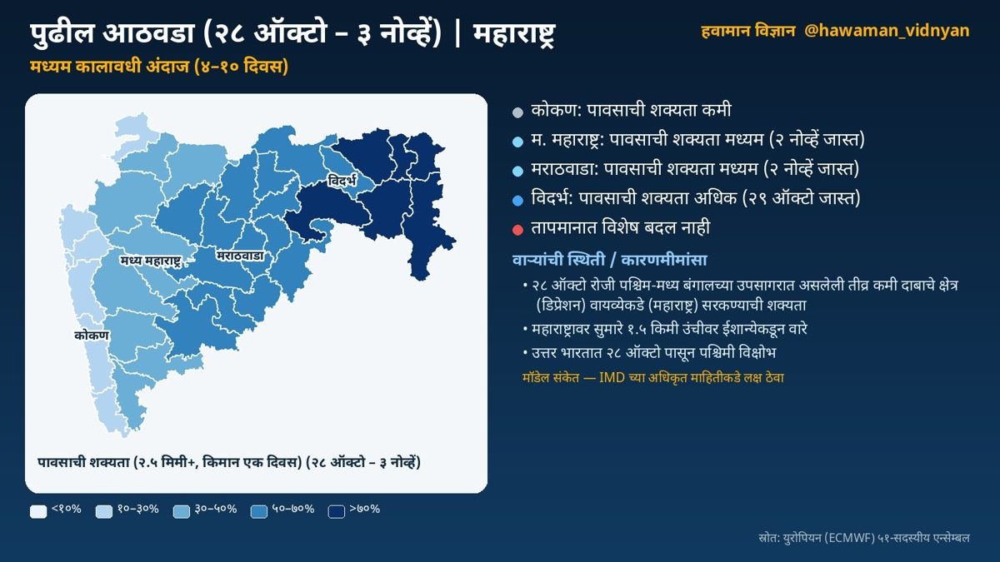
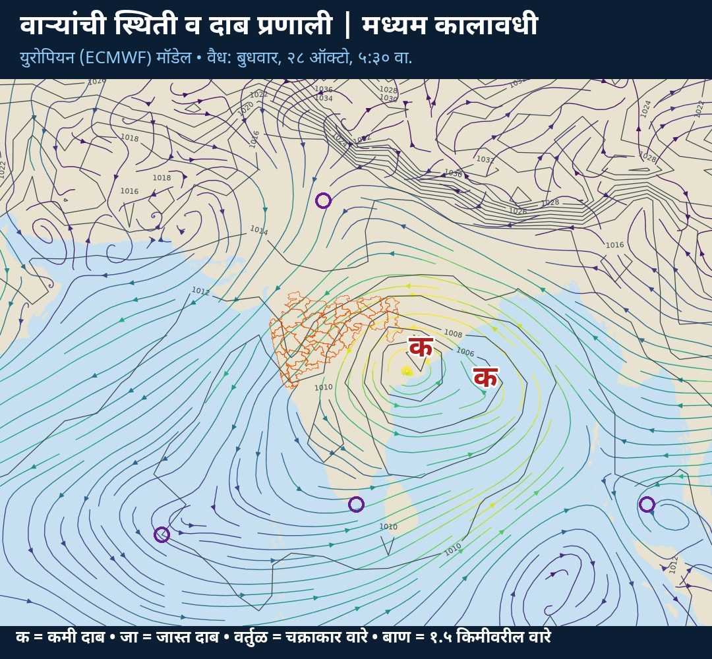

**मध्यम कालावधी अंदाज** · स्रोत: हवामान विज्ञान स्वयंचलित विश्लेषण

☔ पावसाची शक्यता:  
⛅ कोकण: कमी  
🌦️ म. महाराष्ट्र: मध्यम  
🌦️ मराठवाडा: मध्यम  
🌧️ विदर्भ: अधिक  
🌀 २८ ऑक्टो रोजी पश्चिम-मध्य बंगालच्या उपसागरात असलेली तीव्र कमी दाबाचे क्षेत्र वायव्येकडे सरकण्याची शक्यता

### हवामानामागचे कारण

🌀 वाऱ्यांची स्थिती व कारणमीमांसा:  
• २८ ऑक्टो रोजी पश्चिम-मध्य बंगालच्या उपसागरात असलेली तीव्र कमी दाबाचे क्षेत्र (डिप्रेशन) वायव्येकडे (महाराष्ट्र) सरकण्याची शक्यता (मॉडेल संकेत; IMD च्या अधिकृत माहितीकडे लक्ष ठेवा). या प्रणालीमुळे राज्यात ढगाळ हवामान व पावसाची शक्यता वाढू शकते

• २८ ऑक्टो रोजी पूर्व भारतावर असलेली तीव्र कमी दाबाचे क्षेत्र (डिप्रेशन) नैऋत्येकडे (महाराष्ट्र) सरकण्याची शक्यता (मॉडेल संकेत; IMD च्या अधिकृत माहितीकडे लक्ष ठेवा)

• महाराष्ट्रावर १ नोव्हें दरम्यान कमी दाबाचे क्षेत्र तयार होण्याचे संकेत; प्रणाली दक्षिणेकडे (पूर्व-मध्य अरबी समुद्र) सरकण्याची शक्यता  
• महाराष्ट्रावर सुमारे १.५ किमी उंचीवर ईशान्येकडून वारे

• उत्तर भारतात २८ ऑक्टो पासून पश्चिमी विक्षोभ; तो पुढे सरकल्यानंतर उत्तरेकडील थंड वाऱ्यांमुळे राज्यात किमान तापमानात घट होऊ शकते  
• पुढील काळात हवेच्या मधल्या थरातील बाष्प वाढत आहे

📌 अधिक तपशील:  
🌡️ तापमानात विशेष बदल नाही

ℹ️ स्रोत: युरोपियन (ECMWF) ५१-सदस्यीय एन्सेम्बल  
⚠️ हा मॉडेल-आधारित अंदाज आहे. अधिकृत इशाऱ्यांसाठी भारतीय हवामान विभाग (IMD) व स्थानिक प्रशासनाच्या सूचना पाहा.

दैनंदिन अपडेटसाठी X वर फॉलो करा: [@hawaman_vidnyan](https://x.com/hawaman_vidnyan)
