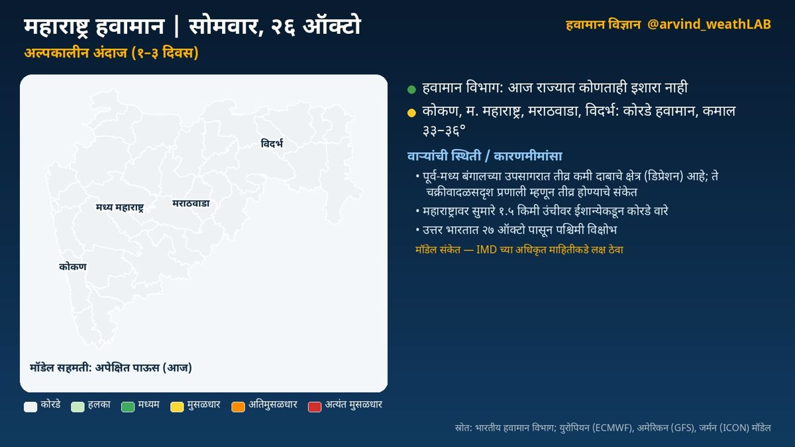
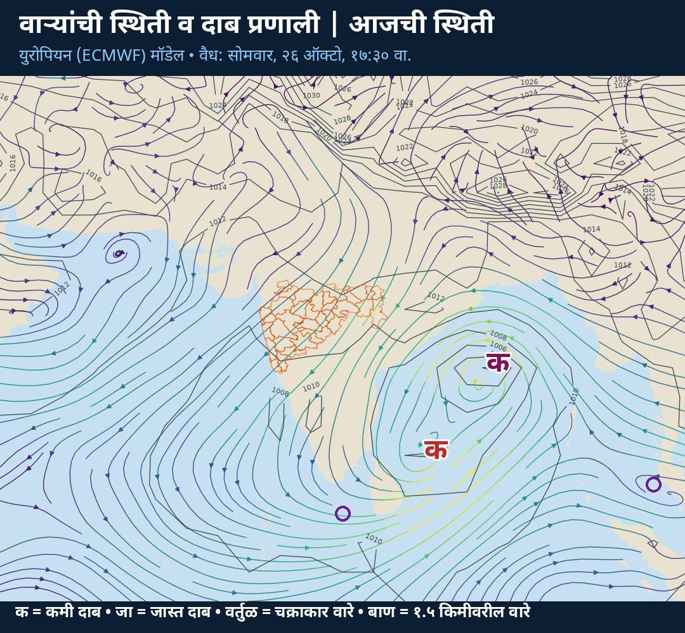
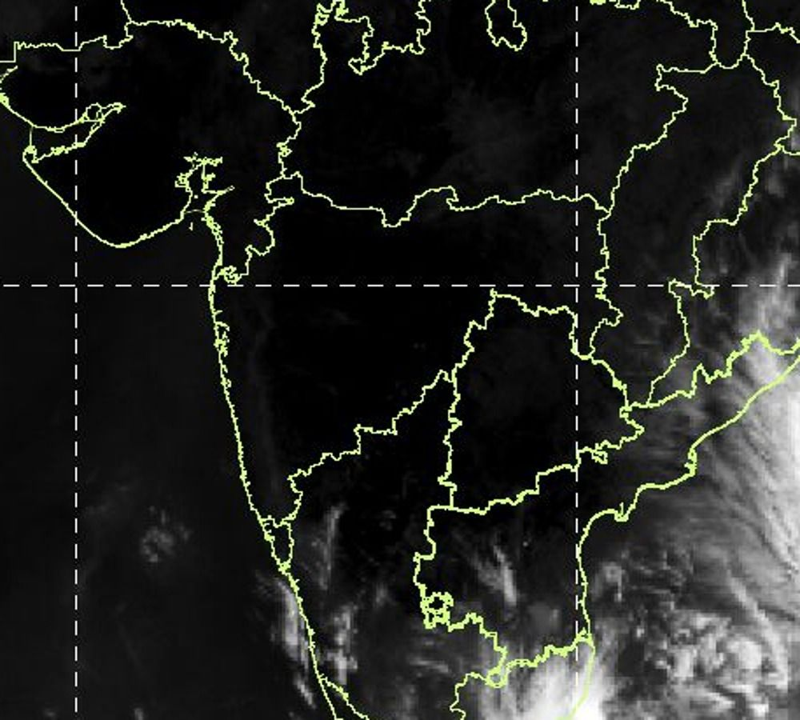

**अल्पकालीन विश्लेषण (१–३ दिवस)** · वैयक्तिक विश्लेषणावर आधारित

✅ हवामान विभाग: आज राज्यात कोणताही इशारा नाही  
☀️ कोकण: कोरडे हवामान  
☀️ म. महाराष्ट्र: कोरडे हवामान  
☀️ मराठवाडा: कोरडे हवामान  
☀️ विदर्भ: कोरडे हवामान  
🌀 पूर्व-मध्य बंगालच्या उपसागरात तीव्र कमी दाबाचे क्षेत्र आहे

### हवामानामागचे कारण

🌀 वाऱ्यांची स्थिती व कारणमीमांसा:

• पूर्व-मध्य बंगालच्या उपसागरात तीव्र कमी दाबाचे क्षेत्र (डिप्रेशन) आहे; ते चक्रीवादळसदृश प्रणाली म्हणून तीव्र होण्याचे संकेत; प्रणाली वायव्येकडे (पूर्व भारत) सरकण्याची शक्यता (मॉडेल संकेत; IMD च्या अधिकृत माहितीकडे लक्ष ठेवा). या प्रणालीमुळे राज्यात ढगाळ हवामान व पावसाची शक्य…

• पूर्व-मध्य अरबी समुद्रात २७ ऑक्टो दरम्यान कमी दाबाचे क्षेत्र तयार होण्याचे संकेत; प्रणाली वायव्येकडे (ईशान्य अरबी समुद्र) सरकण्याची शक्यता  
• नैऋत्य बंगालच्या उपसागरात कमी दाबाचे क्षेत्र आहे

• महाराष्ट्रावर सुमारे १.५ किमी उंचीवर ईशान्येकडून कोरडे वारे; हवेच्या मधल्या थरात आर्द्रता फक्त ४०% असल्याने ढग फारसे तयार होत नाहीत  
• उत्तर भारतात २७ ऑक्टो पासून पश्चिमी विक्षोभ; तो पुढे सरकल्यानंतर उत्तरेकडील थंड वाऱ्यांमुळे राज्यात किमान तापमानात घट होऊ शकते

• पुढील काळात हवेच्या मधल्या थरातील बाष्प वाढत आहे

🏙️ आज शहरांचे कमाल/किमान तापमान (हवामान विभाग):  
मुंबई ३६/२६, रत्नागिरी ३५/२४, पुणे ३५/१७, नाशिक ३५/१८, कोल्हापूर ३४/२२, छ. ३५/१९, नागपूर ३४/१७

📌 निरीक्षणे:  
🌡️ काल सर्वाधिक: मुंबई (सांताक्रूझ) ३६.५°  
❄️ नीचांकी: जळगाव १५.४°  
🛰️ उपग्रह: राज्यावर आकाश बहुतांश निरभ्र (कोकण १%, मध्य महाराष्ट्र १%, मराठवाडा ०%, विदर्भ १% ढगाच्छादन)

ℹ️ स्रोत: भारतीय हवामान विभाग; युरोपियन (ECMWF), अमेरिकन (GFS), जर्मन (ICON) मॉडेल  
⚠️ हे मॉडेल-आधारित विश्लेषण आहे. अधिकृत इशाऱ्यांसाठी भारतीय हवामान विभाग (IMD) व स्थानिक प्रशासनाच्या सूचना पाहा.

## सविस्तर हवामान विश्लेषण

### अल्पकालीन विश्लेषण (१–३ दिवस)
नमस्कार! आज सोमवार, २६ ऑक्टोबर. पाहूया महाराष्ट्राचे हवामान विश्लेषण. हवामान विभागाने आज राज्यात कोणताही इशारा दिलेला नाही. कोकण: कोरडे हवामान. कमाल तापमान सुमारे ३६ आणि किमान २२ अंश सेल्सिअस. मध्य महाराष्ट्र: कोरडे हवामान. कमाल तापमान सुमारे ३५ आणि किमान २० अंश सेल्सिअस. मराठवाडा: कोरडे हवामान. कमाल तापमान सुमारे ३३ आणि किमान १९ अंश सेल्सिअस. विदर्भ: कोरडे हवामान. कमाल तापमान सुमारे ३४ आणि किमान १८ अंश सेल्सिअस. काल राज्यातील सर्वाधिक तापमान मुंबई (सांताक्रूझ) येथे ३६.५ अंश (सरासरीपेक्षा २.३° जास्त) नोंदले गेले. आता पाहूया हवामानामागचे कारण, म्हणजेच वाऱ्यांची स्थिती. पूर्व-मध्य बंगालच्या उपसागरात तीव्र कमी दाबाचे क्षेत्र (डिप्रेशन) आहे; ते चक्रीवादळसदृश प्रणाली म्हणून तीव्र होण्याचे संकेत; प्रणाली वायव्येकडे (पूर्व भारत) सरकण्याची शक्यता (मॉडेल संकेत; IMD च्या अधिकृत माहितीकडे लक्ष ठेवा). या प्रणालीमुळे राज्यात ढगाळ हवामान व पावसाची शक्यता वाढू शकते. पूर्व-मध्य अरबी समुद्रात २७ ऑक्टो दरम्यान कमी दाबाचे क्षेत्र तयार होण्याचे संकेत; प्रणाली वायव्येकडे (ईशान्य अरबी समुद्र) सरकण्याची शक्यता. नैऋत्य बंगालच्या उपसागरात कमी दाबाचे क्षेत्र आहे. महाराष्ट्रावर सुमारे १.५ किमी उंचीवर ईशान्येकडून कोरडे वारे; हवेच्या मधल्या थरात आर्द्रता फक्त ४०% असल्याने ढग फारसे तयार होत नाहीत. उत्तर भारतात २७ ऑक्टो पासून पश्चिमी विक्षोभ; तो पुढे सरकल्यानंतर उत्तरेकडील थंड वाऱ्यांमुळे राज्यात किमान तापमानात घट होऊ शकते. पुढील काळात हवेच्या मधल्या थरातील बाष्प वाढत आहे.

### मध्यम कालावधी विश्लेषण (४–१० दिवस)
आता पुढील आठवड्याचा, म्हणजे २९ ऑक्टो – ४ नोव्हें या काळाचे विश्लेषण. युरोपियन हवामान केंद्राच्या ५१ वेगवेगळ्या संभाव्य मॉडेल-परिणामांवर आधारित. कोकण: पावसाची शक्यता मध्यम. मध्य महाराष्ट्र: पावसाची शक्यता अधिक (२ नोव्हें जास्त). मराठवाडा: पावसाची शक्यता खूप अधिक (२ नोव्हें जास्त). विदर्भ: पावसाची शक्यता अधिक (२९ ऑक्टो जास्त).  तापमानात विशेष बदल नाही. या काळातील वाऱ्यांची स्थिती: नैऋत्य बंगालच्या उपसागरात १ नोव्हें दरम्यान तीव्र कमी दाबाचे क्षेत्र (डिप्रेशन) तयार होण्याचे संकेत; प्रणाली वायव्येकडे (महाराष्ट्र) सरकण्याची शक्यता (मॉडेल संकेत; IMD च्या अधिकृत माहितीकडे लक्ष ठेवा). या प्रणालीमुळे राज्यात ढगाळ हवामान व पावसाची शक्यता वाढू शकते. २९ ऑक्टो रोजी पूर्व भारतावर असलेली तीव्र कमी दाबाचे क्षेत्र (डिप्रेशन) उत्तरेकडे (मध्य भारत) सरकण्याची शक्यता (मॉडेल संकेत; IMD च्या अधिकृत माहितीकडे लक्ष ठेवा). महाराष्ट्रावर २९ ऑक्टो दरम्यान कमी दाबाचे क्षेत्र तयार होण्याचे संकेत. महाराष्ट्रावर सुमारे १.५ किमी उंचीवर ईशान्येकडून वारे.

### विस्तारित विश्लेषण (२–४ आठवडे)
आता पुढील तीन आठवड्यांचा विस्तारित विश्लेषण. आठवडा १, २–८ नोव्हें: म. महाराष्ट्र, मराठवाडा: पाऊस जास्त. तापमान सरासरीपेक्षा १.८ अंश जास्त राहण्याची शक्यता. आठवडा २, ९–१५ नोव्हें: पाऊस सरासरीइतका. तापमान सरासरीपेक्षा १.४ अंश जास्त राहण्याची शक्यता. आठवडा ३, १६–२२ नोव्हें: पाऊस सरासरीइतका. तापमान सरासरीपेक्षा १.६ अंश जास्त राहण्याची शक्यता. वाऱ्यांचा प्रवाह: २–९ नोव्हें: महाराष्ट्रावर पूर्वेकडून वारे कायम (५१ पैकी ५१ सदस्य); पूर्व/ईशान्येकडील वारे सहसा कोरडे हवामान आणतात. भारतीय हवामान विभाग व आयआयटीएम पुणे यांचे विस्तारित कालावधी नकाशेही हेच संकेत तपासण्यासाठी पाहा.

### हंगामी विश्लेषण (१–३ महिने)
आता नोव्हेंबर ते जानेवारी या हंगामाचा दीर्घकालीन विश्लेषण. नोव्हेंबर: तापमान सरासरीपेक्षा बरेच जास्त, सुमारे +२.५ अंश; पाऊस सरासरीइतका. डिसेंबर: तापमान सरासरीपेक्षा बरेच जास्त, सुमारे +२.३ अंश; पाऊस सरासरीइतका. जानेवारी: तापमान सरासरीपेक्षा बरेच जास्त, सुमारे +२.१ अंश; पाऊस सरासरीइतका. प्रशांत महासागरात तीव्र एल निनो (नीनो-३.४: +३.३°से); तो अजून बळकट होत आहे. एल निनोमुळे येणारा हिवाळा सहसा उबदार; थंडीच्या लाटा कमी.

हे मॉडेल-आधारित विश्लेषण आहे. अधिकृत इशाऱ्यांसाठी भारतीय हवामान विभाग (IMD) व स्थानिक प्रशासनाच्या सूचना पाहा.

दैनंदिन अपडेटसाठी X वर फॉलो करा: [@arvind_weathLAB](https://x.com/arvind_weathLAB)
