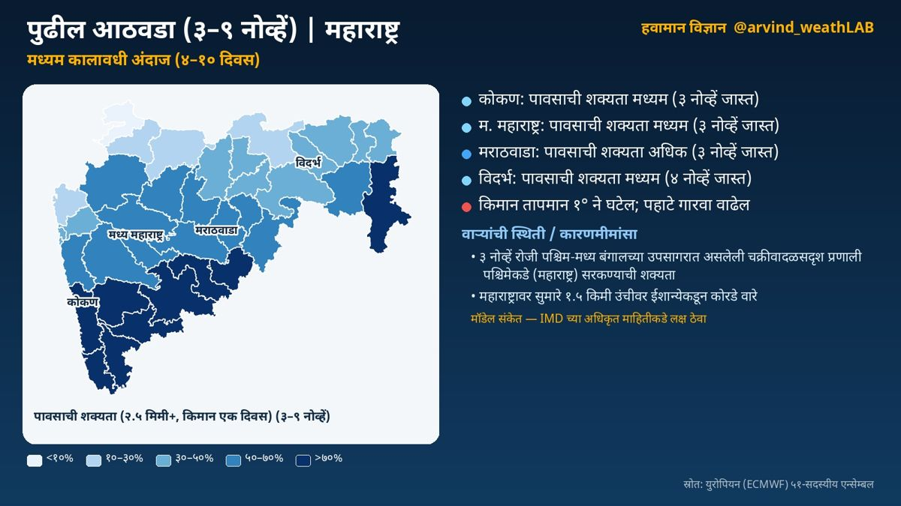
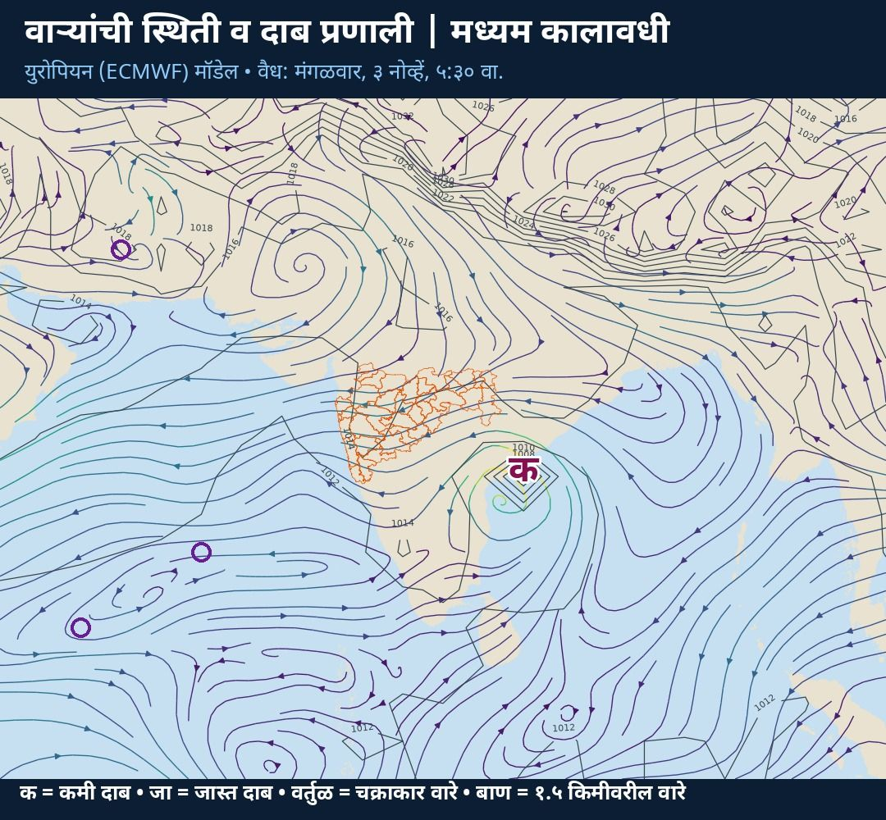

**मध्यम कालावधी विश्लेषण (४–१० दिवस)** · वैयक्तिक विश्लेषणावर आधारित

☔ पावसाची शक्यता:  
🌦️ कोकण: मध्यम  
🌦️ म. महाराष्ट्र: मध्यम  
🌧️ मराठवाडा: अधिक  
🌦️ विदर्भ: मध्यम  
🌀 ३ नोव्हें रोजी पश्चिम-मध्य बंगालच्या उपसागरात असलेली चक्रीवादळसदृश प्रणाली पश्चिमेकडे सरकण्याची शक्यता

### हवामानामागचे कारण

🌀 वाऱ्यांची स्थिती व कारणमीमांसा:  
• ३ नोव्हें रोजी पश्चिम-मध्य बंगालच्या उपसागरात असलेली चक्रीवादळसदृश प्रणाली पश्चिमेकडे (महाराष्ट्र) सरकण्याची शक्यता (मॉडेल संकेत; IMD च्या अधिकृत माहितीकडे लक्ष ठेवा). या प्रणालीमुळे राज्यात ढगाळ हवामान व पावसाची शक्यता वाढू शकते

• महाराष्ट्रावर सुमारे १.५ किमी उंचीवर ईशान्येकडून कोरडे वारे; हवेच्या मधल्या थरात आर्द्रता फक्त ४३% असल्याने ढग फारसे तयार होत नाहीत  
• पुढील काळात हवेच्या मधल्या थरातील बाष्प कमी होत आहे

📌 अधिक तपशील:  
🌡️ किमान तापमान १° ने घटेल; पहाटे गारवा वाढेल

ℹ️ स्रोत: युरोपियन (ECMWF) ५१-सदस्यीय एन्सेम्बल  
⚠️ हे मॉडेल-आधारित विश्लेषण आहे. अधिकृत इशाऱ्यांसाठी भारतीय हवामान विभाग (IMD) व स्थानिक प्रशासनाच्या सूचना पाहा.

## सविस्तर हवामान विश्लेषण

### अल्पकालीन विश्लेषण (१–३ दिवस)
नमस्कार! आज शनिवार, ३१ ऑक्टोबर. पाहूया महाराष्ट्राचे हवामान विश्लेषण. कोकण: तुरळक ठिकाणी हलका पाऊस. कमाल तापमान सुमारे ३३ आणि किमान २२ अंश सेल्सिअस. मध्य महाराष्ट्र: काही ठिकाणी हलका पाऊस. कमाल तापमान सुमारे ३२ आणि किमान २० अंश सेल्सिअस. मराठवाडा: तुरळक ठिकाणी हलका पाऊस. कमाल तापमान सुमारे ३२ आणि किमान २१ अंश सेल्सिअस. विदर्भ: कोरडे हवामान. कमाल तापमान सुमारे ३१ आणि किमान २० अंश सेल्सिअस. आता पाहूया हवामानामागचे कारण, म्हणजेच वाऱ्यांची स्थिती. आग्नेय बंगालच्या उपसागरात कमी दाबाचे क्षेत्र आहे; ते चक्रीवादळसदृश प्रणाली म्हणून तीव्र होण्याचे संकेत; प्रणाली वायव्येकडे (पश्चिम-मध्य बंगालचा उपसागर) सरकण्याची शक्यता (मॉडेल संकेत; IMD च्या अधिकृत माहितीकडे लक्ष ठेवा). आग्नेय अरबी समुद्रात ३१ ऑक्टो दरम्यान कमी दाबाचे क्षेत्र तयार होण्याचे संकेत; प्रणाली पश्चिमेकडे (पश्चिम-मध्य अरबी समुद्र) सरकण्याची शक्यता. महाराष्ट्रावर सुमारे १.५ किमी उंचीवर पूर्वेकडून वारे.

### मध्यम कालावधी विश्लेषण (४–१० दिवस)
आता पुढील आठवड्याचा, म्हणजे ३–९ नोव्हें या काळाचे विश्लेषण. युरोपियन हवामान केंद्राच्या ५१ वेगवेगळ्या संभाव्य मॉडेल-परिणामांवर आधारित. कोकण: पावसाची शक्यता मध्यम (३ नोव्हें जास्त). मध्य महाराष्ट्र: पावसाची शक्यता मध्यम (३ नोव्हें जास्त). मराठवाडा: पावसाची शक्यता अधिक (३ नोव्हें जास्त). विदर्भ: पावसाची शक्यता मध्यम (४ नोव्हें जास्त).  किमान तापमान १° ने घटेल; पहाटे गारवा वाढेल. या काळातील वाऱ्यांची स्थिती: ३ नोव्हें रोजी पश्चिम-मध्य बंगालच्या उपसागरात असलेली चक्रीवादळसदृश प्रणाली पश्चिमेकडे (महाराष्ट्र) सरकण्याची शक्यता (मॉडेल संकेत; IMD च्या अधिकृत माहितीकडे लक्ष ठेवा). या प्रणालीमुळे राज्यात ढगाळ हवामान व पावसाची शक्यता वाढू शकते. महाराष्ट्रावर सुमारे १.५ किमी उंचीवर ईशान्येकडून कोरडे वारे; हवेच्या मधल्या थरात आर्द्रता फक्त ४३% असल्याने ढग फारसे तयार होत नाहीत. पुढील काळात हवेच्या मधल्या थरातील बाष्प कमी होत आहे.

### विस्तारित विश्लेषण (२–४ आठवडे)
आता पुढील तीन आठवड्यांचा विस्तारित विश्लेषण. आठवडा १, २–८ नोव्हें: कोकण, म. महाराष्ट्र, मराठवाडा: पाऊस जास्त. तापमान सरासरीपेक्षा १.३ अंश जास्त राहण्याची शक्यता. आठवडा २, ९–१५ नोव्हें: राज्यभर पाऊस सरासरीपेक्षा कमी. तापमान सरासरीपेक्षा ०.७ अंश जास्त राहण्याची शक्यता. आठवडा ३, १६–२२ नोव्हें: पाऊस सरासरीइतका. तापमान सरासरीपेक्षा १.१ अंश जास्त राहण्याची शक्यता. वाऱ्यांचा प्रवाह: ७–१४ नोव्हें: महाराष्ट्रावर ईशान्येकडून वारे कायम (५१ पैकी ५१ सदस्य); पूर्व/ईशान्येकडील वारे सहसा कोरडे हवामान आणतात. भारतीय हवामान विभाग व आयआयटीएम पुणे यांचे विस्तारित कालावधी नकाशेही हेच संकेत तपासण्यासाठी पाहा.

### हंगामी विश्लेषण (१–३ महिने)
आता नोव्हेंबर ते जानेवारी या हंगामाचा दीर्घकालीन विश्लेषण. नोव्हेंबर: तापमान सरासरीपेक्षा बरेच जास्त, सुमारे +२.५ अंश; पाऊस सरासरीइतका. डिसेंबर: तापमान सरासरीपेक्षा बरेच जास्त, सुमारे +२.३ अंश; पाऊस सरासरीइतका. जानेवारी: तापमान सरासरीपेक्षा बरेच जास्त, सुमारे +२.१ अंश; पाऊस सरासरीइतका. प्रशांत महासागरात तीव्र एल निनो (नीनो-३.४: +३.४°से); तो अजून बळकट होत आहे. एल निनोमुळे येणारा हिवाळा सहसा उबदार; थंडीच्या लाटा कमी.

हे मॉडेल-आधारित विश्लेषण आहे. अधिकृत इशाऱ्यांसाठी भारतीय हवामान विभाग (IMD) व स्थानिक प्रशासनाच्या सूचना पाहा.

दैनंदिन अपडेटसाठी X वर फॉलो करा: [@arvind_weathLAB](https://x.com/arvind_weathLAB)
