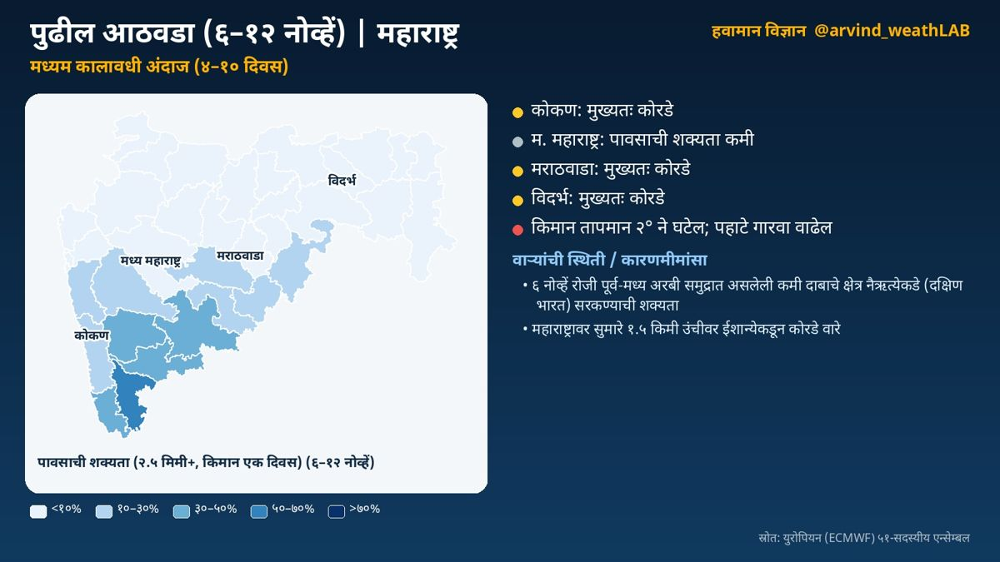
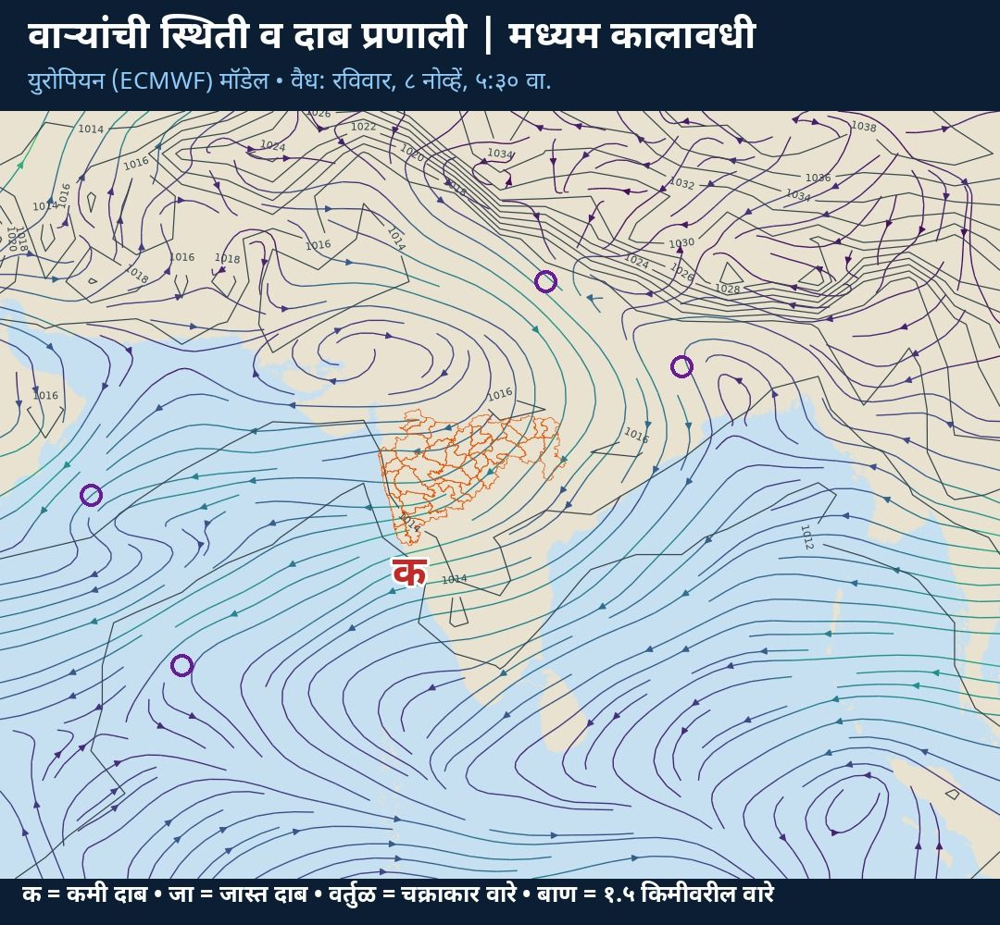

**मध्यम कालावधी विश्लेषण (४ ते १० दिवस)** · वैयक्तिक विश्लेषणावर आधारित

☀️ कोकण: मुख्यतः कोरडे  
⛅ म. महाराष्ट्र: पावसाची शक्यता कमी  
☀️ मराठवाडा: मुख्यतः कोरडे  
☀️ विदर्भ: मुख्यतः कोरडे  
🌀 ६ नोव्हें रोजी पूर्व-मध्य अरबी समुद्रात असलेली कमी दाबाचे क्षेत्र नैऋत्येकडे सरकण्याची शक्यता

### हवामानामागचे कारण

🌀 वाऱ्यांची स्थिती व कारणमीमांसा:  
• ६ नोव्हें रोजी पूर्व-मध्य अरबी समुद्रात असलेली कमी दाबाचे क्षेत्र नैऋत्येकडे (दक्षिण भारत) सरकण्याची शक्यता. या प्रणालीमुळे राज्यात ढगाळ हवामान व पावसाची शक्यता वाढू शकते

• पूर्व भारतावर ७ नोव्हें दरम्यान कमी दाबाचे क्षेत्र तयार होण्याचे संकेत; प्रणाली दक्षिणेकडे (ईशान्य बंगालचा उपसागर) सरकण्याची शक्यता  
• महाराष्ट्रावर सुमारे १.५ किमी उंचीवर ईशान्येकडून कोरडे वारे; हवेच्या मधल्या थरात आर्द्रता फक्त १८% असल्याने ढग फारसे तयार होत नाहीत

• पुढील काळात हवेच्या मधल्या थरातील बाष्प कमी होत आहे

📌 अधिक तपशील:  
🌡️ किमान तापमान २° ने घटेल; पहाटे गारवा वाढेल

ℹ️ स्रोत: युरोपियन (ECMWF) ५१-सदस्यीय एन्सेम्बल  
⚠️ हे मॉडेल-आधारित विश्लेषण आहे. अधिकृत इशाऱ्यांसाठी भारतीय हवामान विभाग (IMD) व स्थानिक प्रशासनाच्या सूचना पाहा.

## सविस्तर हवामान विश्लेषण

### अल्पकालीन विश्लेषण (१ ते ३ दिवस)
नमस्कार! आज मंगळवार, ३ नोव्हेंबर. पाहूया महाराष्ट्राचे हवामान विश्लेषण. कोकण: तुरळक ठिकाणी हलका पाऊस. कमाल तापमान सुमारे ३५ आणि किमान २३ अंश सेल्सिअस. मध्य महाराष्ट्र: कोरडे हवामान. कमाल तापमान सुमारे ३४ आणि किमान २० अंश सेल्सिअस. मराठवाडा: कोरडे हवामान. कमाल तापमान सुमारे ३२ आणि किमान २० अंश सेल्सिअस. विदर्भ: कोरडे हवामान. कमाल तापमान सुमारे ३३ आणि किमान २० अंश सेल्सिअस. आता पाहूया हवामानामागचे कारण, म्हणजेच वाऱ्यांची स्थिती. महाराष्ट्रावर कमी दाबाचे क्षेत्र आहे; प्रणाली पश्चिमेकडे (पूर्व-मध्य अरबी समुद्र) सरकण्याची शक्यता. या प्रणालीमुळे राज्यात ढगाळ हवामान व पावसाची शक्यता वाढू शकते. ईशान्य भारतावर ३ नोव्हें दरम्यान कमी दाबाचे क्षेत्र तयार होण्याचे संकेत. महाराष्ट्रावर सुमारे १.५ किमी उंचीवर ईशान्येकडून वारे. पुढील काळात हवेच्या मधल्या थरातील बाष्प कमी होत आहे.

### मध्यम कालावधी विश्लेषण (४ ते १० दिवस)
आता पुढील आठवड्याचा, म्हणजे ६ ते १२ नोव्हें या काळाचे विश्लेषण. युरोपियन हवामान केंद्राच्या ५१ वेगवेगळ्या संभाव्य मॉडेल-परिणामांवर आधारित. कोकण: मुख्यतः कोरडे. मध्य महाराष्ट्र: पावसाची शक्यता कमी. मराठवाडा: मुख्यतः कोरडे. विदर्भ: मुख्यतः कोरडे.  किमान तापमान २° ने घटेल; पहाटे गारवा वाढेल. या काळातील वाऱ्यांची स्थिती: ६ नोव्हें रोजी पूर्व-मध्य अरबी समुद्रात असलेली कमी दाबाचे क्षेत्र नैऋत्येकडे (दक्षिण भारत) सरकण्याची शक्यता. या प्रणालीमुळे राज्यात ढगाळ हवामान व पावसाची शक्यता वाढू शकते. पूर्व भारतावर ७ नोव्हें दरम्यान कमी दाबाचे क्षेत्र तयार होण्याचे संकेत; प्रणाली दक्षिणेकडे (ईशान्य बंगालचा उपसागर) सरकण्याची शक्यता. महाराष्ट्रावर सुमारे १.५ किमी उंचीवर ईशान्येकडून कोरडे वारे; हवेच्या मधल्या थरात आर्द्रता फक्त १८% असल्याने ढग फारसे तयार होत नाहीत. पुढील काळात हवेच्या मधल्या थरातील बाष्प कमी होत आहे.

### विस्तारित विश्लेषण (२ ते ४ आठवडे)
आता पुढील तीन आठवड्यांचा विस्तारित विश्लेषण. आठवडा १, ९ ते १५ नोव्हें: राज्यभर पाऊस सरासरीपेक्षा कमी. तापमान सरासरीपेक्षा १.२ अंश जास्त राहण्याची शक्यता. आठवडा २, १६ ते २२ नोव्हें: कोकण: पाऊस जास्त. तापमान सरासरीपेक्षा १.५ अंश जास्त राहण्याची शक्यता. आठवडा ३, २३ ते २९ नोव्हें: पाऊस सरासरीइतका. तापमान सरासरीपेक्षा १.५ अंश जास्त राहण्याची शक्यता. वाऱ्यांचा प्रवाह: १० ते १७ नोव्हें: महाराष्ट्रावर पूर्वेकडून वारे कायम (५१ पैकी ५१ सदस्य); पूर्व/ईशान्येकडील वारे सहसा कोरडे हवामान आणतात. भारतीय हवामान विभाग व आयआयटीएम पुणे यांचे विस्तारित कालावधी नकाशेही हेच संकेत तपासण्यासाठी पाहा.

### हंगामी विश्लेषण (१ ते ३ महिने)
आता नोव्हेंबर ते जानेवारी या हंगामाचा दीर्घकालीन विश्लेषण. नोव्हेंबर: तापमान सरासरीपेक्षा बरेच जास्त, सुमारे +२.५ अंश; पाऊस सरासरीइतका. डिसेंबर: तापमान सरासरीपेक्षा बरेच जास्त, सुमारे +२.३ अंश; पाऊस सरासरीइतका. जानेवारी: तापमान सरासरीपेक्षा बरेच जास्त, सुमारे +२.१ अंश; पाऊस सरासरीइतका. प्रशांत महासागरात तीव्र एल निनो (नीनो-३.४: +३.४°से); तो अजून बळकट होत आहे. एल निनोमुळे येणारा हिवाळा सहसा उबदार; थंडीच्या लाटा कमी.

हे मॉडेल-आधारित विश्लेषण आहे. अधिकृत इशाऱ्यांसाठी भारतीय हवामान विभाग (IMD) व स्थानिक प्रशासनाच्या सूचना पाहा.

दैनंदिन अपडेटसाठी X वर फॉलो करा: [@arvind_weathLAB](https://x.com/arvind_weathLAB)
